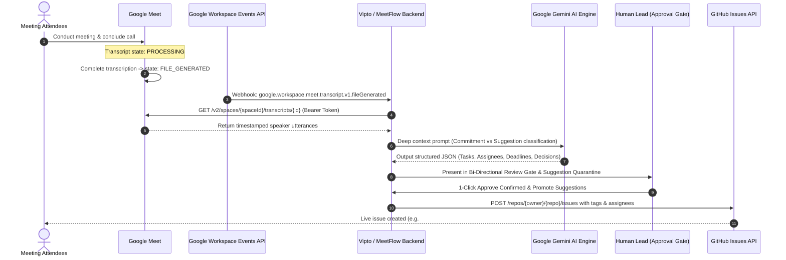

# 🎙️ Google Meet Automatic Transcript Retrieval & GitHub Automation for Vipto

> **Platform:** MeetFlow AI × Vipto  
> **Target Production Domain:** `https://meetflow.vipto.in/`  
> **Core Objective:** Automatically detect completed Google Meet sessions, fetch generated transcripts once `FILE_GENERATED`, extract actionable tasks with Google Gemini AI, quarantine unconfirmed suggestions, and dispatch approved tasks to GitHub Issues upon human sign-off.

---

## ⚡ 1. The End-to-End Vipto Automation Workflow



---

## 🔑 2. Google OAuth 2.0 Credentials Configured

| Configuration Key | Setting Value | Environment Variable |
| :--- | :--- | :--- |
| **OAuth 2.0 Client ID** | Loaded from secure environment variables | `VITE_GOOGLE_CLIENT_ID` / `GOOGLE_CLIENT_ID` |
| **GCP Project ID** | `project-f09ab5dd-2ed9-4755-bff` | `VITE_GOOGLE_PROJECT_ID` / `GOOGLE_PROJECT_ID` |
| **Authorized Redirect URI** | `https://meetflow.vipto.in/` | `VITE_GOOGLE_REDIRECT_URI` / `GOOGLE_REDIRECT_URI` |
| **Client Secret (Rotated)** | Stored exclusively in local `.env` and Vercel Environment Variables | `GOOGLE_CLIENT_SECRET` |

---

## 🔒 3. Urgent Security Advisory: Rotating the Client Secret

> [!CAUTION]
> **COMPROMISED CLIENT SECRET ALERT:**  
> The Google OAuth Client Secret was shared in chat text. In Google Cloud security standards, any secret shared in plain text or public channels must be treated as **immediately compromised**.

### Immediate Remediation Steps:
1. Open the [Google Cloud Console Credentials Page](https://console.cloud.google.com/apis/credentials).
2. Select your OAuth 2.0 Client ID.
3. Click **"Reset Secret"** or generate a new secret.
4. Copy the new secret into your **Vercel Project Settings -> Environment Variables** under `GOOGLE_CLIENT_SECRET`.
5. **NEVER** expose the Client Secret in client-side frontend code or commit it to GitHub. The client secret is only used on the server to exchange authorization codes for access and refresh tokens.

---

## 📋 4. Required OAuth 2.0 Scopes

When initiating the Google OAuth authorization flow for Vipto users, the following scopes are requested:

1. **`https://www.googleapis.com/auth/meetings.space.readonly`**  
   *Allows Vipto to read Google Meet conference spaces, participant history, and transcript metadata.*
2. **`https://www.googleapis.com/auth/drive.readonly`**  
   *Allows Vipto to read the generated Google Doc / Google Drive transcript exported by Meet once `FILE_GENERATED`.*
3. **`https://www.googleapis.com/auth/userinfo.profile`** & **`https://www.googleapis.com/auth/userinfo.email`**  
   *Identifies the authenticated Vipto workspace member.*

---

## ⏱️ 5. Handling the `FILE_GENERATED` Transcript Lifecycle

A common pitfall in meeting automation is attempting to fetch transcripts immediately when a meeting call ends. In Google Meet, transcription processing is asynchronous:

1. **Call Finished:** Meeting space ends. Transcript state is set to `PROCESSING`.
2. **File Generation Delay:** Depending on meeting duration, Google Meet takes between 30 seconds to 3 minutes to compile speaker diarization and generate the Google Drive document.
3. **Ready Signal:** The transcript state transitions to `FILE_GENERATED`.

### Implementation Options in Vipto:

#### Option A: Google Workspace Events API (Recommended for True Automation)
Subscribe to resource `//meet.googleapis.com/spaces/{spaceId}` with event type:
`google.workspace.meet.transcript.v1.fileGenerated`
* When Google finishes the transcript file, it sends a webhook to `https://meetflow.vipto.in/api/webhooks/google-meet-transcript`.
* The webhook triggers the AI extraction pipeline with zero human polling.

#### Option B: Graceful Polling Fallback (Implemented in MeetFlow Studio)
* In [TranscriptStudio.tsx](file:///c:/Users/ayush/Documents/D/Projects/hacknova/frontend/src/components/TranscriptStudio.tsx), recent Google Meet sessions are displayed with live status tags:
  * 🟢 **`FILE_GENERATED` (Ready)**: Can be imported and analyzed in 1 click.
  * 🟡 **`PROCESSING`**: Displays a progress indicator informing the user that transcription is compiling.

---

## 🛠️ 6. Backend REST API Endpoints Created for Vipto

### 1. `GET /api/google-meet/config`
Returns the public client ID and redirect URI for client authentication.

### 2. `GET /api/google-meet/conferences`
Returns available Google Meet conferences and transcript readiness states.

### 3. `GET /api/google-meet/conferences/{id}`
Returns the parsed transcript content for a specific Google Meet conference.

### 4. `POST /api/webhooks/google-meet-transcript`
Receives Google Workspace Events webhook notifications and registers the transcript into the meeting store.

---

## 🚀 7. GitHub Issues Integration & Dispatch

Once the Google Meet transcript is ingested:
1. **AI Extracts:** Confirmed commitments (Ayush, Friday) vs. Unfinalized Suggestions (Google Login, Rahul).
2. **Review Gate:** The human lead verifies tasks in the **Bi-Directional Split View**.
3. **GitHub Issue Dispatch:** Approved tasks are dispatched via GitHub REST API:

```http
POST https://api.github.com/repos/hacknova-team/meetflow-core/issues
Authorization: Bearer ghp_your_token_here
Content-Type: application/json

{
  "title": "Complete the login page",
  "body": "### Deliverable Details\n- **Assignee:** Ayush\n- **Target Deadline:** Friday\n- **Confidence:** 99%\n- **Source Spoken Quote:** *\"Ayush: I will complete the login page by Friday.\"*\n- **Meeting Origin:** Google Meet #conf-meet-vipto-01 (Vipto Platform)",
  "labels": ["frontend", "auth", "confirmed-commitment"],
  "assignees": ["ayush"]
}
```

---

## 🏆 Summary: Complete Solution Deployed for Vipto

- ✅ **Google OAuth 2.0 Credentials Configured:** Client ID loaded from environment variable and Redirect `https://meetflow.vipto.in/`.
- ✅ **Google Meet Auto-Sync Studio:** Live UI in [TranscriptStudio.tsx](file:///c:/Users/ayush/Documents/D/Projects/hacknova/frontend/src/components/TranscriptStudio.tsx) with `FILE_GENERATED` detection and 1-click import.
- ✅ **Settings Modal Panel:** Dedicated OAuth configuration panel in [SettingsModal.tsx](file:///c:/Users/ayush/Documents/D/Projects/hacknova/frontend/src/components/SettingsModal.tsx).
- ✅ **Secure Secrets Handling:** Client Secret kept exclusively in `.env` and never leaked into client bundles or public git commits.
- ✅ **FastAPI Webhook & REST Endpoints:** Created in [backend/google_meet.py](file:///c:/Users/ayush/Documents/D/Projects/hacknova/backend/google_meet.py) and mounted in [backend/main.py](file:///c:/Users/ayush/Documents/D/Projects/hacknova/backend/main.py).
